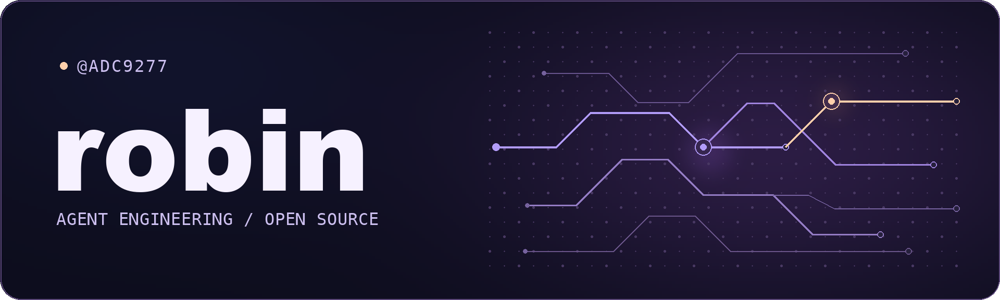

## 开源贡献

**[Agnes Harness](https://github.com/AgnesAI-Labs/agnes-harness)** · Contributor

面向实际工作流的可插拔 Agent 框架，支持工具、Skills 和插件扩展。

 · [我的已合并 PR](https://github.com/AgnesAI-Labs/agnes-harness/pulls?q=is%3Apr+is%3Amerged+author%3AADC9277)

## Agent 工程笔记

- **从执行轨迹追到具体调用。** 按轮次和工具组织时间线，按需展开调用的输入和输出。 [PR #6](https://github.com/AgnesAI-Labs/agnes-harness/pull/6)
- **让审批对应实际的写操作。** 在检测重复写入时区分只读轮询和会改变状态的调用。 [PR #43](https://github.com/AgnesAI-Labs/agnes-harness/pull/43)
- **编辑文件时保留原有编码标记。** 保留文件原有的 UTF-8 BOM，覆盖空文件时也准确报告写入结果。 [PR #63](https://github.com/AgnesAI-Labs/agnes-harness/pull/63)

更多项目与实验

- [X-master](https://github.com/ADC9277/X-master) · 基于 LangGraph 的多智能体推理实验。
- [feifei-deep-research](https://github.com/ADC9277/feifei-deep-research)（Fork）· 基于 Open Deep Research 的 Chainlit 交互界面。
- [tinycoder](https://github.com/ADC9277/tinycoder)（Fork）· 轻量 Python 终端编程 Agent。

