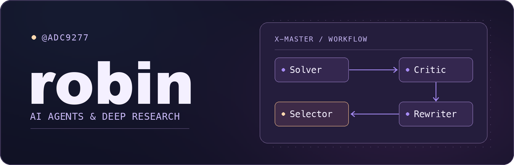

## 项目

- [**X-master**](https://github.com/ADC9277/X-master) · 用 LangGraph 串起求解、审阅、改写和选择，探索多智能体推理。
- [**feifei-deep-research**](https://github.com/ADC9277/feifei-deep-research)（Fork）· 基于 Open Deep Research，使用 Chainlit 提供研究流程的交互界面。
- [**tinycoder**](https://github.com/ADC9277/tinycoder)（Fork）· 轻量 Python 终端编程 Agent，支持工具调用、会话管理和上下文压缩。
